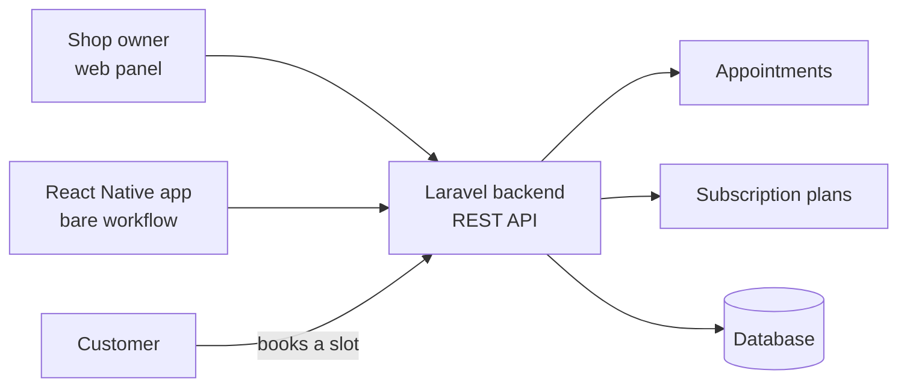
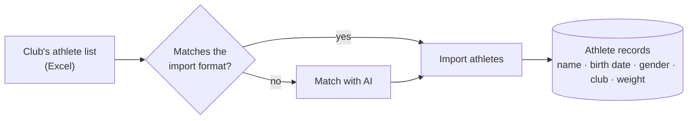
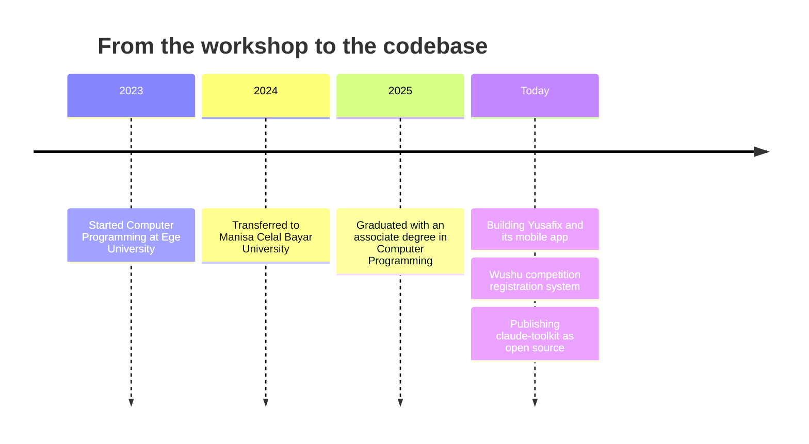

<!--
  Profile README for yusuf35350
  The blocks between the REPOS, ACTIVITY, CONTRIBUTIONS and UPDATED start/end markers are
  rewritten daily by scripts/update-readme.mjs; edit everything else freely.
-->

<p align="center">
  
</p>

<p align="center">
  <a href="https://github.com/yusuf35350">
    
  </a>
</p>

<p align="center">
  <a href="https://github.com/yusuf35350/claude-toolkit"></a>
  <a href="https://instagram.com/yusafixcom"></a>
</p>

<p align="center">
  
  
  <a href="https://github.com/yusuf35350?tab=followers"></a>
  
</p>

<p align="center">
  <b>🇬🇧 English</b> &nbsp;·&nbsp; <a href="README.tr.md">🇹🇷 Türkçe</a>
</p>

<p align="center">
  <a href="#-about-me">About</a> ·
  <a href="#-what-i-build">What I build</a> ·
  <a href="#-tech-stack">Stack</a> ·
  <a href="#-projects">Projects</a> ·
  <a href="#-mcp--claude">MCP & Claude</a> ·
  <a href="#-open-source">Open source</a> ·
  <a href="#-github-analytics">Analytics</a> ·
  <a href="#-useful-links">Links</a> ·
  <a href="#-lets-build-something">Contact</a>
</p>

---

## 👋 About Me

I'm **Yusuf**, a developer from **İzmir, Türkiye**. I build **web apps with PHP & Laravel**, **mobile apps with React Native**, **desktop (PC) apps**, and I also do **game design**. Lately most of my free time goes into **MCP servers, Claude Code skills and local LLMs**.

I'm also part of **Nes Motors**, a motorcycle sales and service business, so a lot of what I build starts as a problem I've seen at the counter: paperwork that should be a form, a spreadsheet that should be a database, a phone call that should be an appointment.

```php
<?php

namespace App\Developers;

final class Yusuf extends Developer
{
    protected string $location  = 'İzmir, Türkiye';
    protected string $education = 'A.S. Computer Programming · Manisa Celal Bayar University (2025)';
    protected array  $languages = ['Turkish', 'English'];

    public function areas(): array
    {
        return ['Web (PHP / Laravel)', 'Mobile apps', 'Game design', 'Desktop (PC) apps', 'MCP & AI tooling'];
    }

    public function stack(): array
    {
        return [
            'backend'  => ['PHP', 'Laravel', 'MySQL', 'REST APIs'],
            'frontend' => ['JavaScript', 'Blade', 'jQuery', 'HTML', 'CSS'],
            'mobile'   => ['React Native (bare workflow)', 'Android Studio'],
            'desktop'  => ['Python', 'CustomTkinter'],
            'ai'       => ['Claude Code', 'MCP', 'Ollama', 'Whisper', 'ChromaDB'],
            'ops'      => ['Git', 'GitHub Actions', 'SSH', 'Hostinger'],
        ];
    }

    public function building(): array
    {
        return [
            'yusafix'        => 'Service management for auto repair shops',
            'wushu'          => 'Athlete registration for wushu competitions',
            'claude-toolkit' => 'Open-source Claude Code skills & MCP servers collection',
        ];
    }

    public function motto(): string
    {
        return 'Ship it, watch real people use it, then make it better.';
    }
}
```

---

## ⚡ Quick Facts

- 🔧 Building **Yusafix**, service management software for auto repair shops (web panel + mobile app)
- 🥋 Building a **registration system for wushu competitions** with AI-assisted Excel import
- 🔌 Maintaining **[claude-toolkit](https://github.com/yusuf35350/claude-toolkit)**: 91 Claude Code skills and 22 MCP servers, curated and kept in sync
- 🎮 Designing games and building **desktop (PC) apps** next to web and mobile work
- 🌱 Learning **MCP server development with FastMCP**, **AI agent architectures** and more **React Native**
- 🤖 Using **Claude Code** every day as a pair programmer and study partner
- 🎓 **Computer Programming** (associate degree), **Manisa Celal Bayar University**, 2025
- 💬 Ask me about **Laravel**, **e-commerce checkout flows**, **SEO**, **MCP** or **deploying Laravel to shared hosting**
- 🏍️ Fun fact: motorcycles are my other world, so a lot of my software ends up being for garages

---

## 🧩 What I Build

<table>
<tr>
<td width="50%" valign="top">

### 🌐 Web
PHP & Laravel apps end to end: database design, admin panels, REST APIs, checkout and payment flows, and production deploys over SSH.

</td>
<td width="50%" valign="top">

### 📱 Mobile
React Native apps (bare workflow, no Expo) on top of Laravel backends, built and debugged in Android Studio.

</td>
</tr>
<tr>
<td width="50%" valign="top">

### 🎮 Game Design
Game ideas, mechanics and prototypes, with AI tooling for engines and 3D assets (Unity, Godot and Blender MCP servers in my toolkit).

</td>
<td width="50%" valign="top">

### 🖥️ Desktop (PC) Apps
Windows desktop tools in Python with CustomTkinter: local utilities, assistants and helpers that run on your own machine.

</td>
</tr>
<tr>
<td width="50%" valign="top">

### 🔌 MCP & AI Tooling
MCP servers, Claude Code skills and local LLM pipelines (Ollama, Whisper, ChromaDB) that connect AI to real tools and data.

</td>
<td width="50%" valign="top">

### 🔧 Business Software
Service tracking, appointments, registrations and sales documents for small businesses and sports organizations.

</td>
</tr>
</table>

---

## 🧰 Tech Stack

<div align="center">

### Web
<picture>
  <source media="(prefers-color-scheme: light)" srcset="https://skillicons.dev/icons?i=php,laravel,mysql,html,css,js,jquery&theme=light">
  
</picture>

### Mobile & Desktop
<picture>
  <source media="(prefers-color-scheme: light)" srcset="https://skillicons.dev/icons?i=react,androidstudio,py,windows&theme=light">
  
</picture>
<br/>


### Game Design


### AI, MCP & Automation


### Tools & Deployment
<picture>
  <source media="(prefers-color-scheme: light)" srcset="https://skillicons.dev/icons?i=git,github,githubactions,vscode&theme=light">
  
</picture>
<br/>


</div>

---

## 🚀 Projects

| Project | What it is | Stack | Status |
|---|---|---|---|
| 🔧 **Yusafix** | Service management system for auto repair shops | Laravel · React Native |  |
| 🥋 **Wushu System** | Athlete registration for wushu (Sanda) competitions | Web app · Excel import · AI matching |  |
| 🔌 **[claude-toolkit](https://github.com/yusuf35350/claude-toolkit)** | 91 Claude Code skills + 22 MCP servers, curated and auto-synced | Skills · MCP · GitHub Actions |  |

<details>
<summary><b>🔧 Yusafix: what's inside</b></summary>
<br/>

Software that helps auto repair shops run their day, starting with appointments.

- **Appointments:** a scheduling module for service bookings
- **Plans:** subscription tiers (such as *Professional*) that shops can request from the site
- **Mobile:** a React Native client (bare workflow, no Expo) on top of the Laravel backend
- **Community:** content for shop owners on Instagram at [@yusafixcom](https://instagram.com/yusafixcom)



</details>

<details>
<summary><b>🥋 Wushu System: what's inside</b></summary>
<br/>

A registration system for wushu (Sanda) competitions, where clubs send athlete lists and the system turns them into clean records.

- **Strict Excel import:** first-row headers `ad | soyad | dogum_tarihi | cinsiyet | kulup | kilo`, dates as `dd.mm.yyyy`, weight as a plain number
- **Validation:** files that don't match the import format are rejected
- **AI matching:** a *"Match with AI"* button maps messy, non-standard lists onto the template



</details>

<details>
<summary><b>🔌 claude-toolkit: what's inside</b></summary>
<br/>

My open-source collection of Claude Code **skills** and **MCP servers**, grouped by the work I do. Skills are copied unmodified from their authors with their licenses; MCP servers are pinned git submodules. A weekly workflow pulls upstream updates as a pull request.

| Category | Skills | Highlights |
|---|---|---|
| 🐘 laravel-php | 25 | Laravel specialist, Eloquent, validation, queues, PHPStan, Rector, Spatie guidelines |
| 📱 mobile | 7 | React Native best practices (Callstack), upgrades, navigation, Flutter |
| 🎮 game-dev | 3 | Game developer, game development, Godot |
| 🖥️ desktop | 5 | Electron, Tauri, C#, Python, CLI tools |
| 🔌 mcp-ai | 8 | MCP builder, skill creator, Claude API, prompt engineering, RAG |
| 🧠 dev-workflow | 26 | Superpowers (brainstorm → plan → TDD → review), Karpathy guidelines, grill-me, handoff |
| 🎨 frontend-design | 13 | Frontend design, web design guidelines, accessibility, Playwright testing, SEO |
| 📄 documents | 4 | Word, PDF, PowerPoint, Excel |

```text
/plugin marketplace add yusuf35350/claude-toolkit
/plugin install laravel-php@claude-toolkit
```

</details>

---

## 🔌 MCP & Claude

<div align="center">
<a href="https://github.com/yusuf35350/claude-toolkit">
  <picture>
    <source media="(prefers-color-scheme: light)" srcset="https://raw.githubusercontent.com/yusuf35350/yusuf35350/output/pin-claude-toolkit-light.svg">
    
  </picture>
</a>
</div>

**MCP servers I use and recommend**, all with one-line installs in [claude-toolkit/mcp](https://github.com/yusuf35350/claude-toolkit/tree/main/mcp):

| Area | Servers |
|---|---|
| 🐘 Laravel & PHP | [Laravel Boost](https://github.com/laravel/boost) · [MySQL](https://github.com/benborla/mcp-server-mysql) · [Laravel MCP](https://github.com/laravel/mcp) · [MCP PHP SDK](https://github.com/modelcontextprotocol/php-sdk) |
| 🧰 Everyday | [Context7](https://github.com/upstash/context7) · [Serena](https://github.com/oraios/serena) · [Reference servers](https://github.com/modelcontextprotocol/servers) · [GitHub](https://github.com/github/github-mcp-server) · [Desktop Commander](https://github.com/wonderwhy-er/DesktopCommanderMCP) |
| 🌐 Browser & testing | [Playwright MCP](https://github.com/microsoft/playwright-mcp) · [Chrome DevTools MCP](https://github.com/ChromeDevTools/chrome-devtools-mcp) |
| 🎮 Game design | [MCP for Unity](https://github.com/CoplayDev/unity-mcp) · [Godot MCP](https://github.com/Coding-Solo/godot-mcp) · [Blender MCP](https://github.com/ahujasid/blender-mcp) |
| 📱 Mobile & design | [Mobile MCP](https://github.com/mobile-next/mobile-mcp) · [Figma Context MCP](https://github.com/GLips/Figma-Context-MCP) |
| 🦙 Local AI | [MCP Client for Ollama](https://github.com/jonigl/mcp-client-for-ollama) |
| 🛠️ Build your own | [FastMCP](https://github.com/PrefectHQ/fastmcp) · [Python SDK](https://github.com/modelcontextprotocol/python-sdk) · [TypeScript SDK](https://github.com/modelcontextprotocol/typescript-sdk) · [MCP Inspector](https://github.com/modelcontextprotocol/inspector) |

**Skill collections I build on:** [anthropics/skills](https://github.com/anthropics/skills) · [obra/superpowers](https://github.com/obra/superpowers) · [jeffallan/claude-skills](https://github.com/jeffallan/claude-skills) · [iserter/laravel-claude-agents](https://github.com/iserter/laravel-claude-agents) · [callstackincubator/agent-skills](https://github.com/callstackincubator/agent-skills) · [addyosmani/agent-skills](https://github.com/addyosmani/agent-skills) · [mattpocock/skills](https://github.com/mattpocock/skills) · [spatie/guidelines-skills](https://github.com/spatie/guidelines-skills) · [laravel/agent-skills](https://github.com/laravel/agent-skills)

---

## 🌍 Open Source

### 🆕 My latest public repositories

<!-- REPOS_START -->
_This list updates automatically every day._
<!-- REPOS_END -->

### 🤝 Contributions to other projects

<!-- CONTRIBUTIONS_START -->
_Merged pull requests to other people's projects show up here automatically._
<!-- CONTRIBUTIONS_END -->

### 📡 Recent activity

<!-- ACTIVITY_START -->
_This list updates automatically every day._
<!-- ACTIVITY_END -->

---

## 🛤️ Journey



---

## 🧠 How I Work

- **Real users first.** Most of what I build runs in a real business or organization, so I care about the boring parts that matter: forms, appointments, imports, invoices.
- **Production is part of the job.** I set up servers, deploys and SEO myself instead of stopping at `localhost`.
- **AI-assisted, not AI-dependent.** Claude Code, skills and MCP make me faster; the architecture decisions stay with me.
- **Local when it matters.** For assistants and personal data I prefer local models (Ollama, Whisper) over sending everything to the cloud.
- **Give credit, share back.** Everything I reuse is credited and linked, and what I collect I publish.

---

## 🖥️ My Setup

| | |
|---|---|
| 💻 **PC** | AMD Ryzen 7 5700X · NVIDIA RTX 5060 (8 GB), built myself |
| 🖨️ **3D printing** | Bambu Lab X2D Combo with AMS |
| 🚁 **Drone** | DJI Mini 5 Pro |
| 🔌 **Electronics** | Arduino: LCD displays and text animations |
| ⌨️ **Editor** | VS Code + Claude Code |
| 🏍️ **Off the keyboard** | Motorcycles |

---

## 📊 GitHub Analytics

<div align="center">

<a href="https://github.com/yusuf35350?tab=repositories">
  <picture>
    <source media="(prefers-color-scheme: light)" srcset="https://raw.githubusercontent.com/yusuf35350/yusuf35350/output/stats-light.svg">
    
  </picture>
</a>
<a href="https://github.com/yusuf35350?tab=repositories">
  <picture>
    <source media="(prefers-color-scheme: light)" srcset="https://raw.githubusercontent.com/yusuf35350/yusuf35350/output/top-langs-light.svg">
    
  </picture>
</a>

<picture>
  <source media="(prefers-color-scheme: light)" srcset="https://streak-stats.demolab.com/?user=yusuf35350&theme=default&hide_border=true">
  
</picture>


<picture>
  <source media="(prefers-color-scheme: light)" srcset="https://raw.githubusercontent.com/yusuf35350/yusuf35350/output/snake-light.svg">
  
</picture>

</div>

---

## 🔗 Useful Links

<table>
<tr>
<td valign="top" width="33%">

**🐘 Laravel & PHP**
- [Laravel docs](https://laravel.com/docs)
- [Laracasts](https://laracasts.com)
- [PHP: The Right Way](https://phptherightway.com)
- [Laravel Boost](https://github.com/laravel/boost)
- [Laravel Skills](https://skills.laravel.cloud)

</td>
<td valign="top" width="33%">

**📱 Mobile, 🎮 Games & 🖥️ Desktop**
- [React Native docs](https://reactnative.dev)
- [Unity Learn](https://learn.unity.com)
- [Godot docs](https://docs.godotengine.org)
- [Blender manual](https://docs.blender.org/manual/en/latest/)
- [CustomTkinter](https://github.com/TomSchimansky/CustomTkinter)

</td>
<td valign="top" width="33%">

**🔌 MCP & Claude**
- [Model Context Protocol](https://modelcontextprotocol.io)
- [MCP Registry](https://registry.modelcontextprotocol.io)
- [Claude Code docs: MCP](https://code.claude.com/docs/en/mcp)
- [awesome-mcp-servers](https://github.com/punkpeye/awesome-mcp-servers)
- [skills.sh](https://skills.sh)

</td>
</tr>
</table>

---

## 🤝 Let's Build Something

I enjoy working with small businesses and fellow developers on:

- **Laravel web apps and admin panels:** from database design to production deploy
- **Mobile apps:** React Native clients for Laravel backends
- **Desktop tools & game prototypes:** small PC apps and playable ideas
- **Business software:** service tracking, appointments, registrations, sales documents
- **MCP & AI:** MCP servers, Claude Code skills and local LLM tooling

<div align="center">

<a href="https://instagram.com/yusafixcom"></a>
<a href="https://github.com/yusuf35350/claude-toolkit"></a>

</div>

<div align="center">

### 💬 Random dev quote


</div>

<!-- UPDATED_START -->
<!-- UPDATED_END -->

<p align="center">
  
</p>
