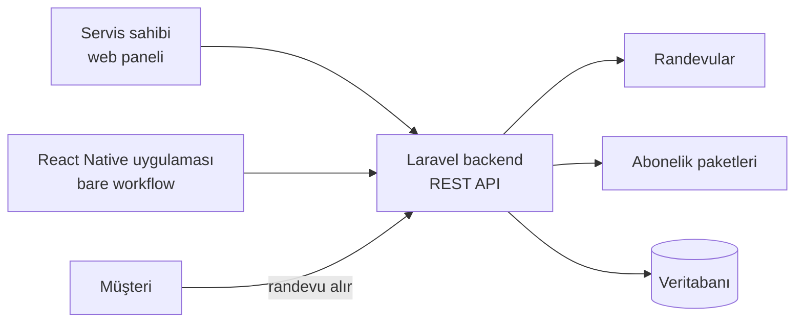
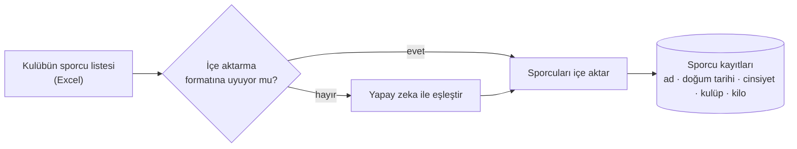
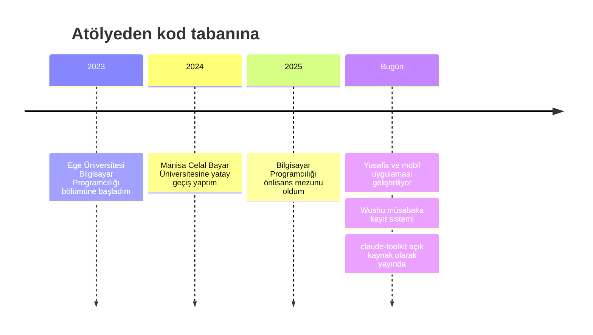

<!--
  yusuf35350 için profil README'si (Türkçe).
  REPOS, ACTIVITY, CONTRIBUTIONS ve UPDATED başlangıç/bitiş işaretleri arasındaki bloklar her gün
  scripts/update-readme.mjs tarafından yeniden yazılır; geri kalanını istediğin gibi düzenle.
-->

<p align="center">
  
</p>

<p align="center">
  <a href="https://github.com/yusuf35350">
    
  </a>
</p>

<p align="center">
  <a href="https://github.com/yusuf35350/claude-toolkit"></a>
  <a href="https://instagram.com/yusafixcom"></a>
</p>

<p align="center">
  
  
  <a href="https://github.com/yusuf35350?tab=followers"></a>
  
</p>

<p align="center">
  <a href="README.md">🇬🇧 English</a> &nbsp;·&nbsp; <b>🇹🇷 Türkçe</b>
</p>

<p align="center">
  <a href="#-hakkımda">Hakkımda</a> ·
  <a href="#-neler-yapıyorum">Neler yapıyorum</a> ·
  <a href="#-teknolojiler">Teknolojiler</a> ·
  <a href="#-projeler">Projeler</a> ·
  <a href="#-mcp--claude">MCP & Claude</a> ·
  <a href="#-açık-kaynak">Açık kaynak</a> ·
  <a href="#istatistikler">İstatistikler</a> ·
  <a href="#-faydalı-linkler">Linkler</a> ·
  <a href="#-birlikte-bir-şey-yapalım">İletişim</a>
</p>

---

## 👋 Hakkımda

Ben **Yusuf**, **İzmir**'li bir geliştiriciyim. **PHP & Laravel ile web uygulamaları**, **React Native ile mobil uygulamalar** ve **PC (masaüstü) uygulamaları** geliştiriyorum, ayrıca **oyun tasarımı** yapıyorum. Son zamanlarda boş vaktimin çoğu **MCP sunucuları, Claude Code skill'leri ve yerel LLM'lere** gidiyor.

Aynı zamanda motosiklet satış ve servis işletmesi **Nes Motors**'un içindeyim. Bu yüzden geliştirdiğim şeylerin çoğu tezgâhta gördüğüm bir sorunla başlıyor: form olması gereken bir evrak, veritabanı olması gereken bir Excel, randevu olması gereken bir telefon görüşmesi.

```php
<?php

namespace App\Developers;

final class Yusuf extends Developer
{
    protected string $konum  = 'İzmir, Türkiye';
    protected string $egitim = 'Bilgisayar Programcılığı (Önlisans) · Manisa Celal Bayar Üniversitesi (2025)';
    protected array  $diller = ['Türkçe', 'İngilizce'];

    public function alanlar(): array
    {
        return ['Web (PHP / Laravel)', 'Mobil uygulama', 'Oyun tasarımı', 'PC (masaüstü) uygulama', 'MCP & yapay zeka araçları'];
    }

    public function teknolojiler(): array
    {
        return [
            'backend'    => ['PHP', 'Laravel', 'MySQL', 'REST API'],
            'frontend'   => ['JavaScript', 'Blade', 'jQuery', 'HTML', 'CSS'],
            'mobil'      => ['React Native (bare workflow)', 'Android Studio'],
            'masaustu'   => ['Python', 'CustomTkinter'],
            'yapay_zeka' => ['Claude Code', 'MCP', 'Ollama', 'Whisper', 'ChromaDB'],
            'devops'     => ['Git', 'GitHub Actions', 'SSH', 'Hostinger'],
        ];
    }

    public function uzerindeCalistiklarim(): array
    {
        return [
            'yusafix'        => 'Oto servisler için servis yönetim sistemi',
            'wushu'          => 'Wushu müsabakaları için sporcu kayıt sistemi',
            'claude-toolkit' => 'Açık kaynak Claude Code skill & MCP sunucu koleksiyonu',
        ];
    }

    public function motto(): string
    {
        return 'Yayına al, gerçek insanların kullanışını izle, sonra daha iyi yap.';
    }
}
```

---

## ⚡ Kısaca

- 🔧 Oto servisler için servis yönetim yazılımı **Yusafix**'i geliştiriyorum (web paneli + mobil uygulama)
- 🥋 Yapay zeka destekli Excel içe aktarmalı bir **wushu müsabaka kayıt sistemi** geliştiriyorum
- 🔌 **[claude-toolkit](https://github.com/yusuf35350/claude-toolkit)**'i yönetiyorum: düzenli güncellenen 91 Claude Code skill'i ve 22 MCP sunucusu
- 🎮 Web ve mobilin yanında oyun tasarlıyorum ve **PC (masaüstü) uygulamaları** geliştiriyorum
- 🌱 **FastMCP ile MCP sunucu geliştirme**, **yapay zeka ajan mimarileri** ve daha fazla **React Native** öğreniyorum
- 🤖 **Claude Code**'u her gün kod ortağı ve çalışma arkadaşı olarak kullanıyorum
- 🎓 **Manisa Celal Bayar Üniversitesi Bilgisayar Programcılığı** önlisans mezunuyum (2025)
- 💬 Bana **Laravel**, **e-ticaret ödeme akışları**, **SEO**, **MCP** ya da **Laravel'i paylaşımlı hostinge kurmak** hakkında soru sorabilirsin
- 🏍️ İlginç bilgi: motosikletler benim diğer dünyam, bu yüzden yazılımlarımın çoğu sonunda servisler ve garajlar için oluyor

---

## 🧩 Neler Yapıyorum

<table>
<tr>
<td width="50%" valign="top">

### 🌐 Web
Uçtan uca PHP & Laravel uygulamaları: veritabanı tasarımı, yönetim panelleri, REST API'ler, sepet ve ödeme akışları, SSH ile canlıya alma.

</td>
<td width="50%" valign="top">

### 📱 Mobil
Laravel backend'ler üzerinde React Native uygulamaları (bare workflow, Expo yok), Android Studio'da derleyip hata ayıklıyorum.

</td>
</tr>
<tr>
<td width="50%" valign="top">

### 🎮 Oyun Tasarımı
Oyun fikirleri, mekanikler ve prototipler; oyun motorları ve 3D varlıklar için yapay zeka araçları (toolkit'imde Unity, Godot ve Blender MCP sunucuları var).

</td>
<td width="50%" valign="top">

### 🖥️ PC (Masaüstü) Uygulamaları
Python ve CustomTkinter ile Windows masaüstü araçları: kendi bilgisayarında çalışan yardımcı uygulamalar, asistanlar ve araçlar.

</td>
</tr>
<tr>
<td width="50%" valign="top">

### 🔌 MCP & Yapay Zeka Araçları
Yapay zekayı gerçek araçlara ve verilere bağlayan MCP sunucuları, Claude Code skill'leri ve yerel LLM akışları (Ollama, Whisper, ChromaDB).

</td>
<td width="50%" valign="top">

### 🔧 İşletme Yazılımları
Küçük işletmeler ve spor organizasyonları için servis takibi, randevu, kayıt ve satış evrakları.

</td>
</tr>
</table>

---

## 🧰 Teknolojiler

<div align="center">

### Web
<picture>
  <source media="(prefers-color-scheme: light)" srcset="https://skillicons.dev/icons?i=php,laravel,mysql,html,css,js,jquery&theme=light">
  
</picture>

### Mobil & Masaüstü
<picture>
  <source media="(prefers-color-scheme: light)" srcset="https://skillicons.dev/icons?i=react,androidstudio,py,windows&theme=light">
  
</picture>
<br/>


### Oyun Tasarımı


### Yapay Zeka, MCP & Otomasyon


### Araçlar & Yayına Alma
<picture>
  <source media="(prefers-color-scheme: light)" srcset="https://skillicons.dev/icons?i=git,github,githubactions,vscode&theme=light">
  
</picture>
<br/>


</div>

---

## 🚀 Projeler

| Proje | Ne yapıyor | Teknoloji | Durum |
|---|---|---|---|
| 🔧 **Yusafix** | Oto servisler için servis yönetim sistemi | Laravel · React Native |  |
| 🥋 **Wushu Sistemi** | Wushu (Sanda) müsabakaları için sporcu kayıt sistemi | Web uygulaması · Excel içe aktarma · Yapay zeka eşleştirme |  |
| 🔌 **[claude-toolkit](https://github.com/yusuf35350/claude-toolkit)** | 91 Claude Code skill'i + 22 MCP sunucusu, seçilmiş ve otomatik güncellenen | Skill · MCP · GitHub Actions |  |

<details>
<summary><b>🔧 Yusafix: içinde neler var</b></summary>
<br/>

Oto servislerin gününü yönetmesine yardım eden, randevuyla başlayan bir yazılım.

- **Randevu:** servis rezervasyonları için randevu modülü
- **Paketler:** servislerin siteden talep edebildiği abonelik paketleri (*Profesyonel* gibi)
- **Mobil:** Laravel backend üzerinde React Native istemci (bare workflow, Expo değil)
- **Topluluk:** servis sahiplerine yönelik içerikler Instagram'da [@yusafixcom](https://instagram.com/yusafixcom)



</details>

<details>
<summary><b>🥋 Wushu Sistemi: içinde neler var</b></summary>
<br/>

Kulüplerin sporcu listelerini gönderdiği ve sistemin bunları düzenli kayıtlara dönüştürdüğü, wushu (Sanda) müsabakaları için bir kayıt sistemi.

- **Kurallı Excel içe aktarma:** ilk satır başlıkları `ad | soyad | dogum_tarihi | cinsiyet | kulup | kilo`, tarih `gg.aa.yyyy`, kilo yalnızca sayı
- **Doğrulama:** içe aktarma formatına uymayan dosyalar reddediliyor
- **Yapay zeka eşleştirme:** *"Yapay zeka ile eşleştir"* butonu, şablona uymayan dağınık listeleri şablona oturtuyor



</details>

<details>
<summary><b>🔌 claude-toolkit: içinde neler var</b></summary>
<br/>

Yaptığım işlere göre gruplanmış, açık kaynak Claude Code **skill** ve **MCP sunucu** koleksiyonum. Skill'ler yazarlarından değiştirilmeden, lisanslarıyla birlikte kopyalandı; MCP sunucuları sabitlenmiş git submodule'leri. Haftalık bir iş, kaynaklardaki güncellemeleri pull request olarak getiriyor.

| Kategori | Skill | Öne çıkanlar |
|---|---|---|
| 🐘 laravel-php | 25 | Laravel uzmanı, Eloquent, doğrulama, kuyruklar, PHPStan, Rector, Spatie kuralları |
| 📱 mobile | 7 | React Native en iyi pratikleri (Callstack), sürüm yükseltme, navigasyon, Flutter |
| 🎮 game-dev | 3 | Oyun geliştirici, oyun geliştirme, Godot |
| 🖥️ desktop | 5 | Electron, Tauri, C#, Python, CLI araçları |
| 🔌 mcp-ai | 8 | MCP builder, skill creator, Claude API, prompt mühendisliği, RAG |
| 🧠 dev-workflow | 26 | Superpowers (beyin fırtınası → plan → TDD → review), Karpathy kuralları, grill-me, handoff |
| 🎨 frontend-design | 13 | Frontend tasarım, web tasarım kuralları, erişilebilirlik, Playwright testleri, SEO |
| 📄 documents | 4 | Word, PDF, PowerPoint, Excel |

```text
/plugin marketplace add yusuf35350/claude-toolkit
/plugin install laravel-php@claude-toolkit
```

</details>

---

## 🔌 MCP & Claude

<div align="center">
<a href="https://github.com/yusuf35350/claude-toolkit">
  <picture>
    <source media="(prefers-color-scheme: light)" srcset="https://raw.githubusercontent.com/yusuf35350/yusuf35350/output/pin-claude-toolkit-light.svg">
    
  </picture>
</a>
</div>

**Kullandığım ve önerdiğim MCP sunucuları**; hepsinin tek satırlık kurulumu [claude-toolkit/mcp](https://github.com/yusuf35350/claude-toolkit/tree/main/mcp) içinde:

| Alan | Sunucular |
|---|---|
| 🐘 Laravel & PHP | [Laravel Boost](https://github.com/laravel/boost) · [MySQL](https://github.com/benborla/mcp-server-mysql) · [Laravel MCP](https://github.com/laravel/mcp) · [MCP PHP SDK](https://github.com/modelcontextprotocol/php-sdk) |
| 🧰 Günlük | [Context7](https://github.com/upstash/context7) · [Serena](https://github.com/oraios/serena) · [Referans sunucular](https://github.com/modelcontextprotocol/servers) · [GitHub](https://github.com/github/github-mcp-server) · [Desktop Commander](https://github.com/wonderwhy-er/DesktopCommanderMCP) |
| 🌐 Tarayıcı & test | [Playwright MCP](https://github.com/microsoft/playwright-mcp) · [Chrome DevTools MCP](https://github.com/ChromeDevTools/chrome-devtools-mcp) |
| 🎮 Oyun tasarımı | [MCP for Unity](https://github.com/CoplayDev/unity-mcp) · [Godot MCP](https://github.com/Coding-Solo/godot-mcp) · [Blender MCP](https://github.com/ahujasid/blender-mcp) |
| 📱 Mobil & tasarım | [Mobile MCP](https://github.com/mobile-next/mobile-mcp) · [Figma Context MCP](https://github.com/GLips/Figma-Context-MCP) |
| 🦙 Yerel yapay zeka | [MCP Client for Ollama](https://github.com/jonigl/mcp-client-for-ollama) |
| 🛠️ Kendi sunucunu yaz | [FastMCP](https://github.com/PrefectHQ/fastmcp) · [Python SDK](https://github.com/modelcontextprotocol/python-sdk) · [TypeScript SDK](https://github.com/modelcontextprotocol/typescript-sdk) · [MCP Inspector](https://github.com/modelcontextprotocol/inspector) |

**Üzerine kurduğum skill koleksiyonları:** [anthropics/skills](https://github.com/anthropics/skills) · [obra/superpowers](https://github.com/obra/superpowers) · [jeffallan/claude-skills](https://github.com/jeffallan/claude-skills) · [iserter/laravel-claude-agents](https://github.com/iserter/laravel-claude-agents) · [callstackincubator/agent-skills](https://github.com/callstackincubator/agent-skills) · [addyosmani/agent-skills](https://github.com/addyosmani/agent-skills) · [mattpocock/skills](https://github.com/mattpocock/skills) · [spatie/guidelines-skills](https://github.com/spatie/guidelines-skills) · [laravel/agent-skills](https://github.com/laravel/agent-skills)

---

## 🌍 Açık Kaynak

### 🆕 Son açık repolarım

<!-- REPOS_START -->
- **[claude-toolkit](https://github.com/yusuf35350/claude-toolkit)** (★ 0): Curated Claude Code skills and MCP servers for Laravel/PHP, mobile, game, desktop and everyday development
<!-- REPOS_END -->

### 🤝 Başka projelere katkılarım

<!-- CONTRIBUTIONS_START -->
_Henüz başka projelerde birleştirilmiş pull request yok. İlkleri yolda._
<!-- CONTRIBUTIONS_END -->

### 📡 Son hareketler

<!-- ACTIVITY_START -->
- **25 Kas** · [feitangyuan/onetake](https://github.com/feitangyuan/onetake) reposuna yıldız verdi
- **25 Kas** · [lemomo-ai/lemo-opuscar](https://github.com/lemomo-ai/lemo-opuscar) reposuna yıldız verdi
- **25 Kas** · [Jakeschincariol/instagram-agent-skill](https://github.com/Jakeschincariol/instagram-agent-skill) reposuna yıldız verdi
- **25 Kas** · [earthtojake/text-to-cad](https://github.com/earthtojake/text-to-cad) reposuna yıldız verdi
- **25 Kas** · [Jakeschincariol/youtube-agent-skill](https://github.com/Jakeschincariol/youtube-agent-skill) reposuna yıldız verdi
- **25 Kas** · [ersinkoc/phonebox](https://github.com/ersinkoc/phonebox) reposuna yıldız verdi
- **22 Kas** · [Jakeschincariol/day-trader-skill](https://github.com/Jakeschincariol/day-trader-skill) reposuna yıldız verdi
- **10 Kas** · [open-jarvis/OpenJarvis](https://github.com/open-jarvis/OpenJarvis) reposuna yıldız verdi
<!-- ACTIVITY_END -->

---

## 🛤️ Yolculuk



---

## 🧠 Nasıl Çalışıyorum

- **Önce gerçek kullanıcı.** Geliştirdiklerimin çoğu gerçek bir işletmede ya da organizasyonda çalışıyor; bu yüzden asıl önemli olan sıkıcı kısımları önemsiyorum: formlar, randevular, içe aktarmalar, faturalar.
- **Canlıya almak da işin parçası.** Sunucuyu, yayına almayı ve SEO'yu `localhost`'ta bırakmadan kendim kuruyorum.
- **Yapay zeka destekli, yapay zekaya bağımlı değil.** Claude Code, skill'ler ve MCP beni hızlandırıyor; mimari kararlar bende kalıyor.
- **Gerektiğinde yerel.** Asistanlar ve kişisel veriler için her şeyi buluta göndermek yerine yerel modelleri (Ollama, Whisper) tercih ediyorum.
- **Emeğe saygı, geri paylaşım.** Kullandığım her şeyin kaynağını belirtiyorum, topladıklarımı da yayınlıyorum.

---

## 🖥️ Kurulumum

| | |
|---|---|
| 💻 **PC** | AMD Ryzen 7 5700X · NVIDIA RTX 5060 (8 GB), kendim topladım |
| 🖨️ **3D yazıcı** | Bambu Lab X2D Combo (AMS'li) |
| 🚁 **Drone** | DJI Mini 5 Pro |
| 🔌 **Elektronik** | Arduino: LCD ekranlar ve yazı animasyonları |
| ⌨️ **Editör** | VS Code + Claude Code |
| 🏍️ **Klavyeden uzakta** | Motosikletler |

---

<a id="istatistikler"></a>

## 📊 GitHub İstatistikleri

<div align="center">

<a href="https://github.com/yusuf35350?tab=repositories">
  <picture>
    <source media="(prefers-color-scheme: light)" srcset="https://raw.githubusercontent.com/yusuf35350/yusuf35350/output/stats-light.svg">
    
  </picture>
</a>
<a href="https://github.com/yusuf35350?tab=repositories">
  <picture>
    <source media="(prefers-color-scheme: light)" srcset="https://raw.githubusercontent.com/yusuf35350/yusuf35350/output/top-langs-light.svg">
    
  </picture>
</a>

<picture>
  <source media="(prefers-color-scheme: light)" srcset="https://streak-stats.demolab.com/?user=yusuf35350&theme=default&hide_border=true&locale=tr">
  
</picture>


<picture>
  <source media="(prefers-color-scheme: light)" srcset="https://raw.githubusercontent.com/yusuf35350/yusuf35350/output/snake-light.svg">
  
</picture>

</div>

---

## 🔗 Faydalı Linkler

<table>
<tr>
<td valign="top" width="33%">

**🐘 Laravel & PHP**
- [Laravel dokümantasyonu](https://laravel.com/docs)
- [Laracasts](https://laracasts.com)
- [PHP: The Right Way](https://phptherightway.com)
- [Laravel Boost](https://github.com/laravel/boost)
- [Laravel Skills](https://skills.laravel.cloud)

</td>
<td valign="top" width="33%">

**📱 Mobil, 🎮 Oyun & 🖥️ Masaüstü**
- [React Native dokümantasyonu](https://reactnative.dev)
- [Unity Learn](https://learn.unity.com)
- [Godot dokümantasyonu](https://docs.godotengine.org)
- [Blender kılavuzu](https://docs.blender.org/manual/en/latest/)
- [CustomTkinter](https://github.com/TomSchimansky/CustomTkinter)

</td>
<td valign="top" width="33%">

**🔌 MCP & Claude**
- [Model Context Protocol](https://modelcontextprotocol.io)
- [MCP Registry](https://registry.modelcontextprotocol.io)
- [Claude Code dokümanı: MCP](https://code.claude.com/docs/en/mcp)
- [awesome-mcp-servers](https://github.com/punkpeye/awesome-mcp-servers)
- [skills.sh](https://skills.sh)

</td>
</tr>
</table>

---

## 🤝 Birlikte Bir Şey Yapalım

Küçük işletmeler ve diğer geliştiricilerle şu konularda çalışmaktan keyif alıyorum:

- **Laravel web uygulamaları ve yönetim panelleri:** veritabanı tasarımından canlıya almaya kadar
- **Mobil uygulamalar:** Laravel backend'ler için React Native istemciler
- **Masaüstü araçlar & oyun prototipleri:** küçük PC uygulamaları ve oynanabilir fikirler
- **İşletme yazılımları:** servis takibi, randevu, kayıt, satış evrakları
- **MCP & yapay zeka:** MCP sunucuları, Claude Code skill'leri ve yerel LLM araçları

<div align="center">

<a href="https://instagram.com/yusafixcom"></a>
<a href="https://github.com/yusuf35350/claude-toolkit"></a>

</div>

<div align="center">

### 💬 Rastgele bir yazılımcı sözü


</div>

<!-- UPDATED_START -->
<p align="center"><sub>Otomatik güncellendi: 27 Kasım 2026 13:19 · İstanbul saati</sub></p>
<!-- UPDATED_END -->

<p align="center">
  
</p>
